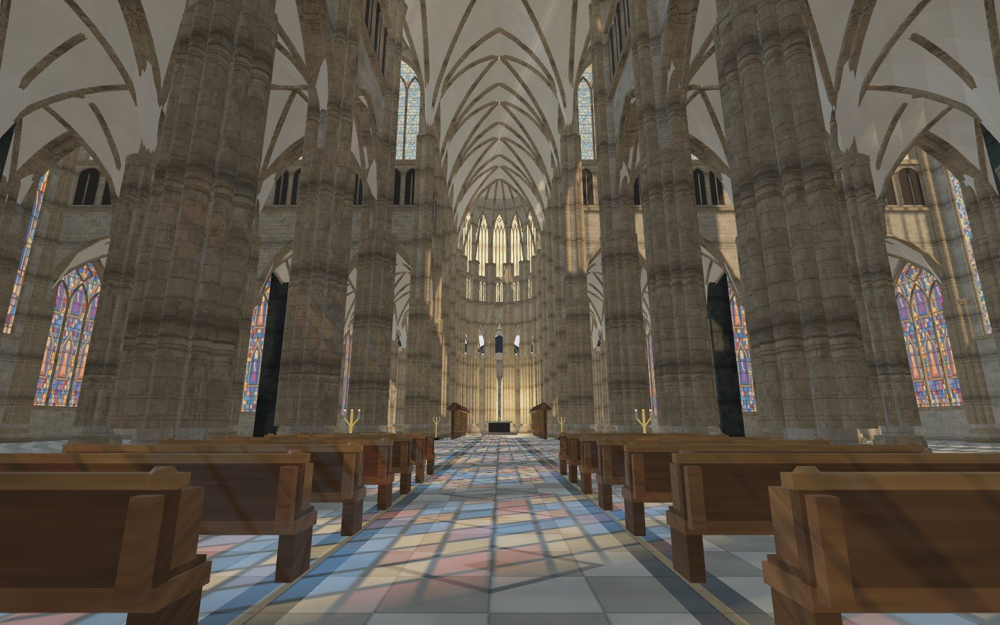
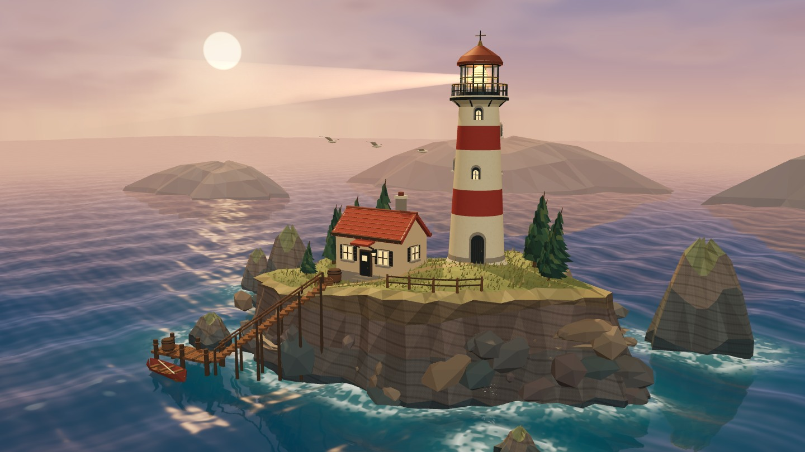
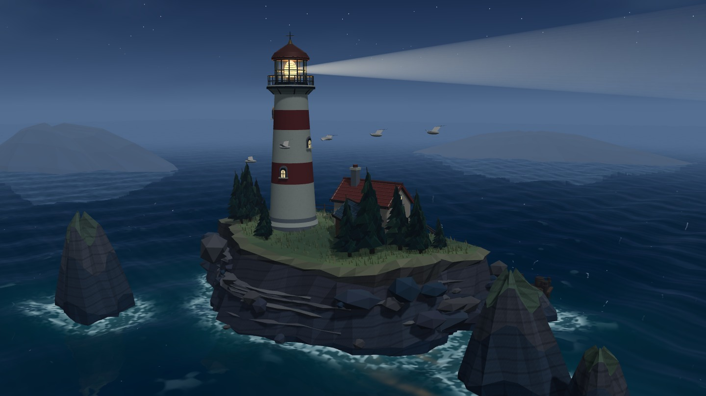

# webGameLab

用 Web 3D 程序建模的游戏场景作品库。这里收录可以走近、环绕观察的环境作品，关注模型轮廓、材质、光照和实时渲染。

**[在线场景目录](https://aevumworks.github.io/webGameLab/)** · [Obsidian 建筑知识库](knowledge/00-工作台.md) · [按参数查看建筑模型](https://aevumworks.github.io/webGameLab/architecture/) · [分期索引](knowledge/制作/分期索引.md)

## WGL-003 · 科隆大教堂 · Kölner Dom

从西门广场仰望双塔，穿过中央门廊，沿木质长椅之间的通道向东行走。交叉部向南看是方格彩窗，继续穿过侧廊，可绕到三王圣龛和东端的七座礼拜堂。

[第一人称参观](https://aevumworks.github.io/webGameLab/scenes/003-cologne-cathedral/) · [本期文件与操作](scenes/003-cologne-cathedral/) · [米制参数与史料](knowledge/建筑/cologne.md) · [历史图纸与实景摄影](scenes/003-cologne-cathedral/references/)

走出西门可以参观 [Domforum 广场](https://aevumworks.github.io/webGameLab/scenes/003-cologne-cathedral/#square)、[中央车站](https://aevumworks.github.io/webGameLab/scenes/003-cologne-cathedral/#station)和[路德维希博物馆](https://aevumworks.github.io/webGameLab/scenes/003-cologne-cathedral/#museum)。街区由 270 栋建筑的测绘数据重建。



## WGL-001 · 雾港 · Fog Harbor

一座建在层状海崖上的灯塔岛。木梯从守灯人的小屋通向水边，栈桥上堆着渔具，旁边系着一条划艇。拖动镜头绕过岛背，可以看到塔后的窗洞、船屋和崖壁凸出的岩层。

[在线环绕游览](https://aevumworks.github.io/webGameLab/scenes/fog-harbor/)



<details>
<summary>从岛的另一侧看月夜</summary>



</details>

| 操作 | 方式 |
| --- | --- |
| 环绕、俯仰 | 鼠标或单指拖动，也可用方向键 |
| 拉近、拉远 | 滚轮、双指缩放、加减键。双击恢复初始镜头 |
| 切换天候 | 选择暮色、月夜或风雨 |
| 暂停环境动画 | 空格或暂停按钮 |
| 纯画面、全屏 | H 隐藏或显示控件，F 切换全屏。触屏轻点画面可找回显示按钮 |

### 模型与渲染

- [建筑与道具](scenes/fog-harbor/buildings.js) 使用旋转体、挤出拱门、屋顶斜面和分段船壳，生成塔身、灯室、环廊栏杆、瓦片、木桶、栈桥与划艇。
- [地形与植被](scenes/fog-harbor/terrain.js) 通过扰动的截面环和三角网格构造玄武岩断面、海蚀柱和远岛。云杉有弯曲的树干和分层伸展的枝叶。
- [海面与天空](scenes/fog-harbor/ocean-sky.js) 使用顶点位移、实时平面反射、岸边泡沫和程序云层。太阳与月光参与水面高光。
- [场景与灯光](scenes/fog-harbor/stage.js) 管理透视相机、阴影、旋转聚光灯、灯束散射、浪花、海鸟和风雨。场景主体在浏览器启动时由代码生成。

### 本地观看

克隆仓库或下载 ZIP，在仓库根目录运行 `node tools/preview.mjs 4182`，打开 [本机目录](http://127.0.0.1:4182/)。科隆大教堂和模型预览台通过 HTTP 读取建筑参数。Three.js 随仓库提供，浏览器需支持 WebGL。

需要便于传送的《雾港》离线文件时，在仓库根目录运行以下命令。

```sh
node tools/standalone.mjs
```

生成的 `dist/fog-harbor.html` 包含引擎和全部建模、渲染代码，可直接双击打开。

## 开源维护

场景按 `scenes/<场景名>/` 归档。欢迎在 Issues 提交场景提案，或附上浏览器、设备与画面反馈渲染问题。新增场景请提供源码入口，以及从实际渲染器截取的预览。主分支由 GitHub Pages 展示。

本仓库原创代码采用 [MIT 许可证](LICENSE)。Three.js r160 保留[上游许可证](vendor/three-r160/LICENSE)。历史图纸与实景摄影的作者、原图和各自的许可见[科隆大教堂素材清单](scenes/003-cologne-cathedral/references/)。
