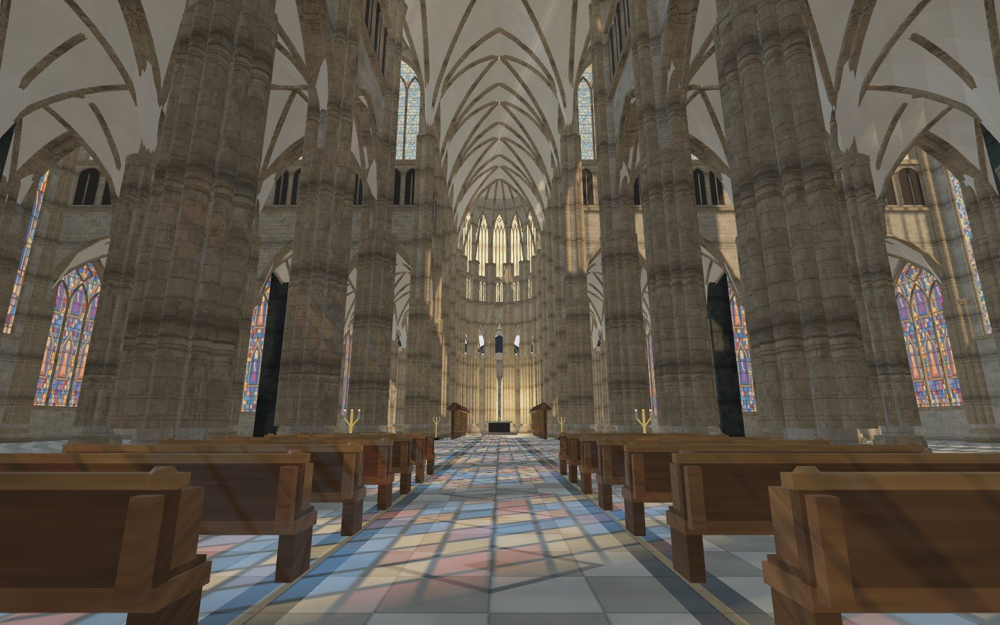
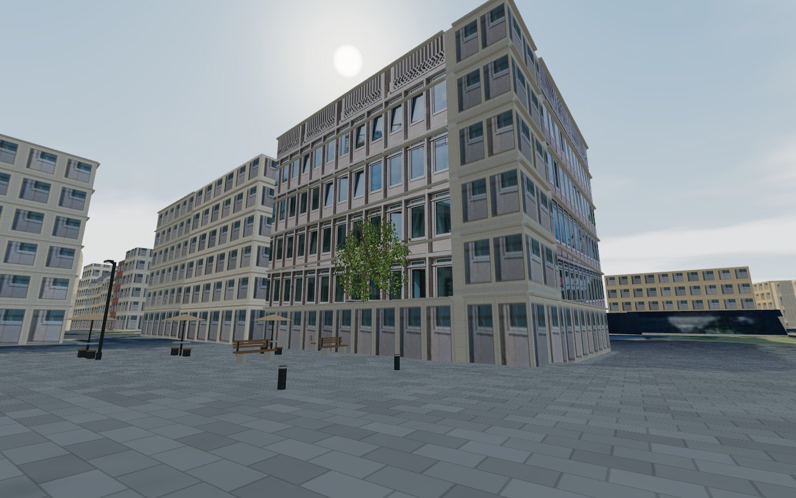
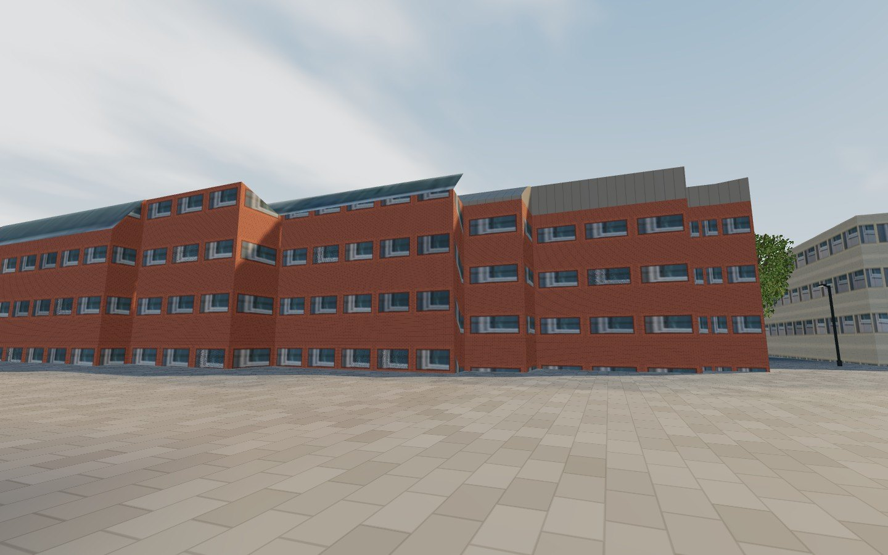

# WGL-003 · 科隆大教堂与主教座堂广场

[进入中殿](https://aevumworks.github.io/webGameLab/scenes/003-cologne-cathedral/) · [西门广场](https://aevumworks.github.io/webGameLab/scenes/003-cologne-cathedral/#west) · [Domforum 街景](https://aevumworks.github.io/webGameLab/scenes/003-cologne-cathedral/#square) · [中央车站](https://aevumworks.github.io/webGameLab/scenes/003-cologne-cathedral/#station) · [路德维希博物馆](https://aevumworks.github.io/webGameLab/scenes/003-cologne-cathedral/#museum)

[观看实机宣传片 01《石与光》](https://aevumworks.github.io/webGameLab/scenes/003-cologne-cathedral/films/01-stone-and-light/) · [影片与摄影源码](films/01-stone-and-light/)

## 游览

默认面朝中殿东端。想从门外进入，可以从西门广场沿中轴前进，穿过中央门廊。交叉部向南能看见方格彩窗，沿侧廊继续向东即可绕到三王圣龛。室外可走进大教堂与 Domforum、中央车站和路德维希博物馆之间的广场。

| 体验 | 桌面 | 手机或平板 |
| --- | --- | --- |
| 行走 | WASD 或 ↑↓，Shift 快走 | 在画面左侧约四成区域按住，从按下的位置向想走的方向滑动 |
| 环顾 | 按住并拖动，←→ 转向，Page Up / Down 改变仰俯角 | 在右侧拖动 |
| 切换地点 | 数字 1–8 直达，M 循环 | 两指同时轻点 |
| 日光与暮光 | L | 在右侧单指双击 |

数字顺序为中殿、西门广场、西门廊、交叉部、唱诗席、Domforum 广场、车站、博物馆。画面始终只显示场景。进入链接可使用 `#nave`、`#west`、`#porch`、`#crossing`、`#choir`、`#square`、`#station` 或 `#museum`。

## 比例与资料

[Obsidian 参数卡](../../knowledge/建筑/cologne.md)驱动教堂的游览与建筑预览台。一世界单位对应一米。中殿拱顶净高 43.35 米，侧廊 19.80 米，南北塔高分别为 157.22 和 157.18 米。五廊柱网参考历史平面图，西立面和飞扶壁以正立面图与唱诗席剖面为依据。三王圣龛按长 2.20 米、宽 1.10 米、高 1.53 米重建。[教堂官方尺寸表](https://www.koelner-dom.de/erleben/der-dom-in-zahlen) · [科隆旅游局](https://www.koelntourismus.de/kunst-kultur/sehenswuerdigkeiten/koelner-dom/innenraum)

周边读取 Geobasis NRW 的 270 栋 LoD2 建筑，共 7,898 个屋面、墙面和地面，在同一坐标系叠合 1 米原始地形和正射航片。Domforum 的上层立面使用透视校正的现场摄影。中央车站以测绘轮廓和 255 × 64 米历史大厅复建玻璃与钢肋，博物馆的锌板锯齿屋顶按屋面分区构造。常规街屋窗框、街具、树木、室内石雕和原作彩窗图案采用参照复原。[建筑测绘数据](https://data.gov.de/suche/daten/3d-gebaudemodell-nw-lod28b9df) · [资料、许可与复建方法](references/)

## 渲染与代码

- [教堂结构](cathedral.js)、[内部](interior.js)、[西立面与外部](exterior.js)、[圣龛](reliquary.js)生成束柱、四分肋架拱顶、尖塔、飞扶壁、彩窗洞口和陈设。
- [石材着色](masonry.js)将扫描石材的颜色、微表面法线和粗糙度投射到世界坐标，近景能读出凿面与接缝。[玻璃](glass.js)表现独立的铅条和色片。彩光投影采取实时近似。
- [光照](light.js)为日光与暮光分别生成预过滤天空环境反射，结合方向光阴影和局部补光。静止画面保留最后一次渲染。[Three.js 标准材质](https://threejs.org/docs/pages/MeshStandardMaterial.html) · [PMREM](https://threejs.org/docs/pages/PMREMGenerator.html)
- [街区](quarter.js)、[地标](landmarks.js)和[广场设施](square.js)使用实测多边形、程序几何和实例化构件。[数据编译器](tools/compile_quarter.py)从公开的城市测绘文件生成随仓库分发的街区数据。
- [漫游](walk.js)以 1.66 米人眼高度行走。室内响应石柱、墙面和长椅碰撞，室外跟随地形，并按建筑地面轮廓约束通行。

在仓库根目录执行 `node tools/preview.mjs 4182` 后可打开[本机体验](http://127.0.0.1:4182/scenes/003-cologne-cathedral/)。[验收记录](../../knowledge/制作/WGL-003%20科隆大教堂验收.md) · [分期索引](../../knowledge/制作/分期索引.md)
