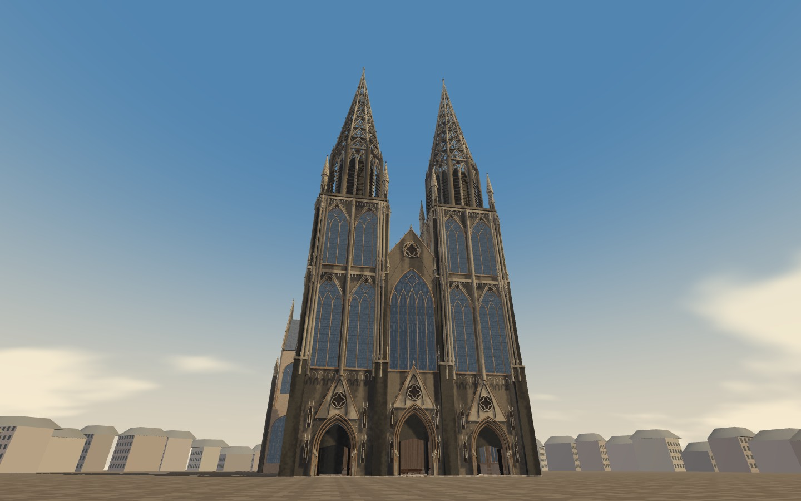

# WGL-003 · 科隆大教堂

[进入第一人称参观](https://aevumworks.github.io/webGameLab/scenes/003-cologne-cathedral/) · [本机验收](http://127.0.0.1:4182/scenes/003-cologne-cathedral/) · [环绕观察模型](https://aevumworks.github.io/webGameLab/architecture/?model=cologne)

## 参观路线

初始视点在中殿，面朝东方。选择「参观位置 → 西立面广场」可从室外开始。穿过中央门廊，沿两排长椅之间的通道进入交叉部。朝南看方格彩窗，再沿侧廊向东进入唱诗席回廊。东端的七座小礼拜堂呈扇形展开。任一位置都可停下查看建筑说明或切换日光、暮光。

| 操作 | 桌面 | 触屏 |
| --- | --- | --- |
| 行走 | W / S 前后，A / D 横移，Shift 快走 | 左下摇杆 |
| 环顾 | 按住画面拖动。← / → 转向，Page Up / Down 调整仰俯 | 在摇杆以外的画面上拖动 |
| 选点和资料 | M 打开位置列表，E 查看当前位置说明，Esc 关闭 | 点「参观位置」或「建筑说明」 |
| 隐藏界面 | H；再按一次恢复 | 隐藏后双击画面可恢复 |

## 模型与渲染

[Obsidian 建筑卡](../../../knowledge/建筑/cologne.md)中的 JSON 直接驱动游览和模型预览台。一米对应一个世界单位。长堂内宽 45.19 米，中殿与侧廊拱顶净高分别为 43.35 米和 19.80 米。双塔按各自的官方高度放样。柱网轴线按历史平面图换算。起拱线、窗槛和人眼高度等复原取值在卡片中单独记录。[官方尺寸表](https://www.koelner-dom.de/erleben/der-dom-in-zahlen)

| 文件 | 内容 |
| --- | --- |
| [interior.js](interior.js) | 五廊柱网、四分肋架拱顶、三层立面、唱诗席、圣龛和放射礼拜堂 |
| [exterior.js](exterior.js) | 西立面门廊、双塔、镂空尖塔、屋脊小塔和双层飞扶壁 |
| [masonry.js](masonry.js) / [glass.js](glass.js) | 合批的三维构件、石材接缝和风化、铅条与彩窗图案 |
| [light.js](light.js) / [scene.js](scene.js) | 天光、阴影、体积光束近似、亮度切换和静止画面重绘控制 |
| [walk.js](walk.js) | 1.66 米人眼视点、门洞与陈设碰撞、键盘和触控漫游 |

石材与木材使用带粗糙度的 Three.js 标准材质，并以世界坐标绘制结构和纹理。窗玻璃随观察者所在的室内或室外改变透光观感。静态建筑仅在天光切换时重新生成阴影图。南横厅窗以独立配色和排列重新绘制，圣龛装饰与门廊雕塑按游览距离概括。广场周边街区作环境背景。本期为建筑游览复原。[Three.js 标准材质](https://threejs.org/docs/pages/MeshStandardMaterial.html) · [Three.js 阴影](https://threejs.org/manual/en/shadows.html)

[查看三份历史图纸与两张实景摄影](references/) · [分期索引](../../../knowledge/制作/分期索引.md) · [体验与视频验收记录](../../../knowledge/制作/WGL-003%20科隆大教堂验收.md)
