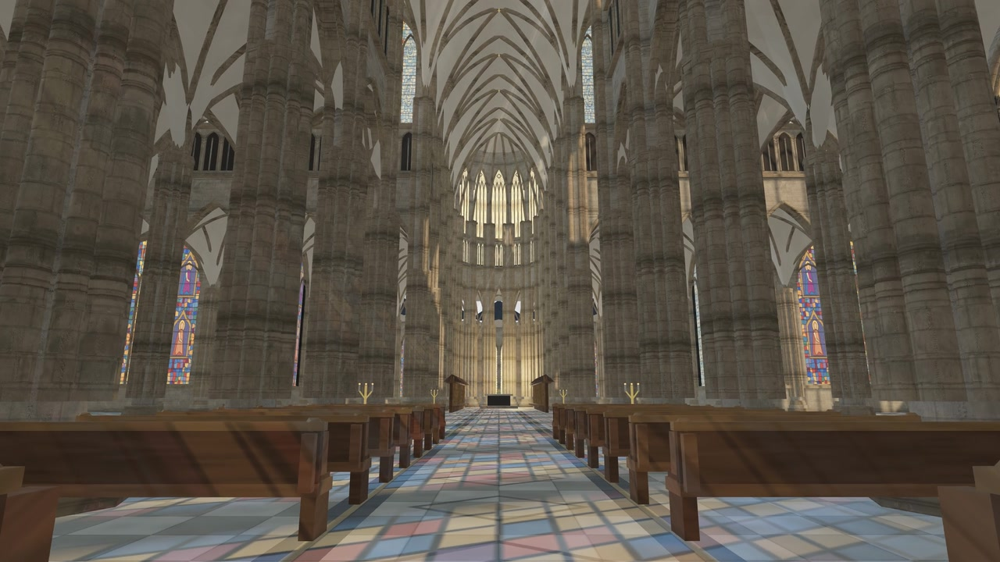

# WGL-003 · 实机宣传片 01《石与光》

[播放完整影片](https://aevumworks.github.io/webGameLab/scenes/003-cologne-cathedral/films/01-stone-and-light/) · [MP4 文件](https://aevumworks.github.io/webGameLab/scenes/003-cologne-cathedral/films/01-stone-and-light/wgl-003-01-stone-and-light.mp4) · [实时重走摄影机路线](https://aevumworks.github.io/webGameLab/scenes/003-cologne-cathedral/films/01-stone-and-light/render.html) · [自己走进教堂](https://aevumworks.github.io/webGameLab/scenes/003-cologne-cathedral/)

[](https://aevumworks.github.io/webGameLab/scenes/003-cologne-cathedral/films/01-stone-and-light/)

镜头从广场仰望西立面双塔，经过 Domforum，沿西门的台阶穿入中殿。彩窗的铅条、交叉的石肋和三王圣龛的金色镶边依次进入近景。暮色中，摄影机沿镂空塔尖抬升，最后拉开到整个街区。

影片为 2560 × 1440、30 帧/秒、45 秒的 H.264 MP4。全片仅含一条视频轨。封面取自第 17 秒的中殿镜头。放映页轻点画面或按空格可暂停，左右方向键可前后跳过 5 秒。

## 复现录制

[镜头表](camera.js)保存十个镜头的位置、朝向、视场角和日光状态。游览与摄影共用[场景渲染器](../../stage.js)。[帧采集脚本](record.js)逐帧读取 WebGL 的 RGBA 帧缓冲，等待编码器接收后才前进一帧，机器实时播放速度不影响成片时长。

在本地检出仓库后，需要支持 WebGL 的浏览器、Python 3.9 或更高版本，以及带 libx264 的 FFmpeg。在本目录执行以下命令，然后用浏览器打开终端给出的本机地址。录制结束后服务自动退出。

```sh
python record.py --output film.mp4
```

可用 `--ffmpeg` 指定可执行文件，`--width` 和 `--height` 指定偶数尺寸。

## 署名与许可

- 《石与光》影像与封面由 webGameLab 制作，按 [CC BY-SA 4.0](https://creativecommons.org/licenses/by-sa/4.0/) 开放。摄影路径及原创代码使用仓库的 [MIT 许可证](../../../../LICENSE)。
- Domforum 上层立面摄影 © Raimond Spekking，原图经裁切、透视校正后贴合三维立面。[摄影原件](https://commons.wikimedia.org/wiki/File:Domforum,_K%C3%B6ln-2263.jpg) · [CC BY-SA 4.0](https://creativecommons.org/licenses/by-sa/4.0/)
- 街区建筑、地形和正射航片来自 Land Nordrhein-Westfalen / Geobasis NRW。[Datenlizenz Deutschland – Zero 2.0](https://www.govdata.de/dl-de/zero-2-0)
- 石材扫描由 Rob Tuytel 为 Poly Haven 制作。[Large Sandstone Blocks · CC0](https://polyhaven.com/a/large_sandstone_blocks)
- 教堂模型的尺寸依据、历史图纸与实景摄影见[场景参考档案](../../references/)。
